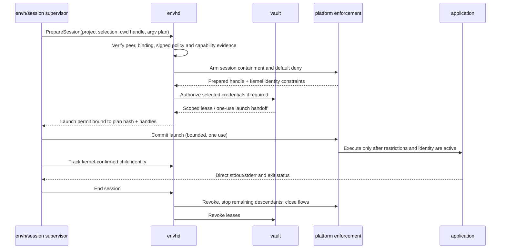

# Architecture

## Process responsibilities

| Component | Privilege and lifetime | Responsibilities | Must not do |
|---|---|---|---|
| `envh` | Developer UID; command lifetime | Parse commands, resolve marker, management UX, coordinate launch | Own master keys; evaluate security based on untrusted strings alone |
| `envhd` | Per-user trusted service; login/session lifetime | Registrations, immutable policy versions, session registry, approvals, audit coordination | Run application code; become a public TCP service; cache unlocked root |
| `envh-vault` | Per-user protected service; on demand | Native/passphrase auth, encrypted objects, operation grants, policy signing | Let managed processes call management operations; log secrets |
| `envh-session` | Per-run trusted supervisor in terminal job | Prepare OS containment, spawn app, terminal/job control, reap/cleanup, lifetime identity | Infer containment from process-group membership alone |
| Platform enforcement service(s) | Least privilege supported by OS; signed native bundles as required | File/network/process restrictions, peer identity, invariant-preserving failure behavior | Handle secret values, plugins, arbitrary config languages |
| `envh-broker` | Constrained per-session process | Approved HTTP mediation and final credential injection, scoped lease, outbound TLS | Listen on public interfaces; accept caller-selected secret names/upstream hosts |
| Custom proxy process | Separately constrained untrusted Go process | Transform protocol messages using explicit capabilities | Load into daemon, access root/vault, open arbitrary network/file paths |
| Approval helper | Trusted native UI or separate management terminal | Show session/destination/action; send bound response | Use the application's stdin/stderr or trust text from that app as UI markup |

These may share source packages, not address spaces across trust boundaries. Per-session broker processes deliberately contain the blast radius of a parser compromise. A centralized broker optimization requires a later review.

Prefer on-demand per-user services launched through platform service management. On macOS use appropriate LaunchAgent/system-extension lifecycle, not a shell daemonization trick. Root ownership is restricted to components the accepted backend actually needs. User installers and signing assets are a separate build/distribution layer.

## Package map

Proposed layout; task ownership follows these boundaries. No skeleton implementation is included yet.

```text
cmd/envh/                 CLI and dispatch
cmd/envhd/                per-user coordinator
cmd/envh-vault/           protected key service
cmd/envh-session/         trusted per-run supervisor
cmd/envh-broker/          constrained HTTP broker
internal/cli/             parsing, management views, stable exit mapping
internal/identity/        ID codec, locator, root discovery, marker I/O
internal/envfile/         bounded deterministic dotenv parser
internal/model/           value types and stable error codes only
internal/policy/          validation, canonicalization, pure decisions
internal/store/           safe atomic files, journal, revision locks
internal/auth/            operation grants; provider interface
internal/vault/           envelopes, manifests, authenticated mutations
internal/session/         state machine, leases, generation fencing
internal/ipc/             framing, strict JSON, dispatch, peer context
internal/approvals/       pending flow state and trusted presentation
internal/audit/           typed redacted events and retention
internal/launch/          environment/FD plan and launch transaction
internal/proxy/           declarative HTTP engine, bounded streaming
internal/plugin/          capability protocol and process supervision
internal/platform/        capability contract and portable types
internal/platform/darwin/ native Go + reviewed CGO/ABI glue
internal/platform/linux/  later independent implementation
internal/platform/windows/later independent implementation
tests/probes/             Go malicious-child fixtures and native harness
tests/integration/        full CLI/coordinator/broker tests
testdata/                 synthetic input/ciphertext/protocol fixtures
packaging/darwin/         bundle manifests, entitlements, signing recipe
specs/                    versioned formats and examples
docs/evidence/            sanitized accepted native evidence
```

Dependency direction: commands → services → pure domain packages. Platform adapters implement interfaces and may depend on domain value types; pure policy/identity/crypto do not import native adapters. Avoid a “utils” package, global mutable registries, and services that import each other cyclically. Use constructor injection and small interfaces owned by consumers.

Initial dependencies: standard library plus reviewed/pinned `x/sys`, `x/crypto/argon2`, and `x/term` if needed for passphrase management. Each addition needs a technical reason and supply-chain review. Use the current supported Go release with a pinned toolchain in the build task; the locally observed Go 1.27.1 is evidence, not a recommended security patch level. No web framework, database, plugin runtime, or CLI framework is necessary initially.

## Launch transaction



Prepare/commit is a contract, not a claim that every platform exposes atomic launch. The native prototype must implement the ordering with no runnable uncontained gap. A future process cannot be safely tracked by a PID guessed before spawn. Disallow `sudo`, setuid/setgid escalation, raw device access, debugger/task ports, and host work-delegation mechanisms unless a reviewed backend confines them.

The launch permit binds session ID, generation, locator, policy hash, executable identity/path resolution, argv digest (not persisted raw argv), cwd object, allowed descriptors, selected environment names, broker endpoints, and monotonic deadline. Native FD/handle transfer carries secret environment payload directly from vault to the session launcher through an authenticated one-use channel, avoiding coordinator logs. Verify object identities again at commit; changed executable, cwd, policy, or peer invalidates preparation.

Partial failure unwinds handles, rules, temporary files, sockets, and leases. Never start the target and “attach the sandbox afterward.” An aborted launch is audited without command/env content.

## Terminal and environment

Keep supervisor and child in the foreground job established by the calling shell. The daemon must not spawn the app in its own detached session. Prefer direct inheritance of descriptors 0/1/2; no pipe pumps or default PTY. Preserve `isatty`, byte streams, colours, progress control codes, pipes, exit status, and working directory. Use OS job-control operations only in the platform adapter and validate Ctrl+C, Ctrl+Z, `fg`, resize, hangup, and broken pipes. Do not forward a terminal-delivered signal a second time to a group already receiving it.

Close all other inherited descriptors except explicitly enumerated one-use bootstrap channels, which must close before untrusted exec. Validate standard descriptors: ordinary files, pipes, and terminals are deliberately granted; sockets and dangerous devices require policy or rejection. No inherited cwd/directory FD may bypass filesystem restrictions. Redirected standard files remain a deliberate user capability even outside path grants.

Environment policy and launch precedence are defined in [behavior](behavior.md). Use a per-session private temp directory and home/config/cache location. Reading necessary host toolchain/runtime files is an explicit reviewed template, never an implicit entire-home grant. First-run compatibility is addressed during initialization/management; no noisy startup banners.

## Sessions, concurrency, and failure

Registry key is `(user scope, session ID, generation)`. Project locators associate sessions without storing raw IDs. A process identity contains OS audit/process-generation information and boot identity in addition to PID. Process groups help job control; they do not define the security tree.

One session actor serializes state transitions and approval consumption; independent sessions execute concurrently. Policy evaluation uses immutable snapshots. Store writes serialize per project locator with expected revisions. Avoid global locks in ES/network callbacks. Callback queues are bounded and default deny under pressure; user approval is never performed synchronously inside an AUTH deadline callback.

Session policy is fixed at launch. Persistent policy edits apply on next launch. Emergency `stop` revokes immediately; do not implement in-place policy broadening in v1. Temporary destination grants live only in the session actor/enforcement state, never in persistent policy.

On top-level app exit, revoke permits and broker credentials first, stop all remaining descendants, await cleanup, then mark Exited. User stop first invalidates grants, closes egress, requests graceful tree termination (2 seconds), then forces termination; identity-safe kill prevents PID reuse errors. Explicit stop can be issued without vault auth by the authenticated owning management peer because it reduces authority. Any ambiguity in selecting a session requires a session ID or `--all`.

Coordinator restart revokes old generations; no session is silently adopted. An enforcement boundary must continue to deny and terminate orphaned restricted sessions. If a platform cannot ensure that across service death, its capability gate fails. A crash journal is for cleanup, not permission resurrection. Sleep/wake and user switching also revalidate state before new authority is issued.

## Audit and observability

Structured append-only event records: event ID, timestamp, monotonic sequence, component, safe project label/locator, session ID/generation, operation category, rule ID, policy version, decision/result code, native test/evidence version. No raw project ID, values, headers, bodies, environment, command args, or full URLs with queries. Domains and paths can contain sensitive data: prefer rule IDs and normalized destination categories; explicit diagnostic capture is a separate authenticated feature outside v1.

Record initialization, auth success/failure category, secret mutation names only after auth, policy revisions, launch/exit/stop, grants/expiry, denied-operation summaries, component failure, plugin lifecycle, and audit loss. Hash-chain events for accidental corruption detection, with documented rollback limits. Rotate at 10 MiB per file, cap at 100 MiB per user by default, and retain at most 30 days. Store local only; no telemetry by default.

Required state changes must have a durable audit intent before granting new authority. If writing fails, reject new launches/authenticated mutations/grants and end affected restricted sessions through the fail-closed path. Repeated deny events can be aggregated with counts; never block an OS callback on disk I/O. Queue saturation denies, signals health failure, and triggers orderly teardown. Hard denial remains active during teardown.

## Distribution and upgrades

Publish source and reproducible checksums/SBOM; sign/notarize macOS packages where required. Do not embed developer certificates or provisioning secrets in the repository. Pin reviewed dependencies and verify release artifacts on a clean system. Installer obtains only required permissions, verifies components, and exposes uninstall instructions.

Upgrade prepares a new signed component set, verifies IPC/proxy major versions and data migrations, stops restricted sessions, replaces services, reruns capability health, and then permits new launches. No live hot-swap of the enforcement boundary in v1. Schema migrations are authenticated, crash-safe, versioned, and must preserve the no-ID-recovery invariant. Never downgrade-read a newer vault format.
