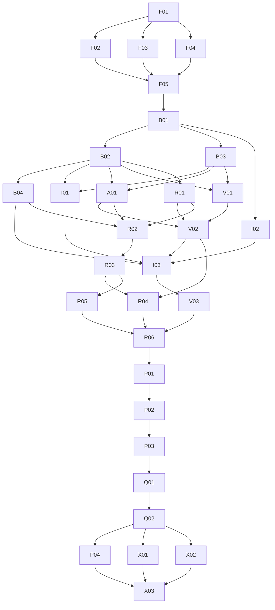

# Roadmap and dependency order

## Milestones

| Milestone | Tasks | Exit condition | Planning envelope, not a commitment |
|---|---|---|---|
| M0 — feasibility | F01–F05 | G0 accepts a concrete macOS boundary and reviewed vault design, or returns an explicit no-go | 2–4 engineer-weeks of experiments, plus unbounded external entitlement/hardware wait |
| M1 — foundations | B01–B04, I01–I02, A01 | Strict parsers, identity, persistence, policy, audit tests pass | 1–2 engineer-weeks |
| M2 — vault/project workflow | V01–V03, I03; uses R01 transport | Authenticated init/import/manage/snap and loss/crash semantics pass | 2–3 engineer-weeks |
| M3 — Standard runtime | R01–R06 | Native launch/enforcement, approvals, concurrent sessions, terminal behavior pass | 3–6 engineer-weeks |
| M4 — Secure + macOS release | P01–P03, Q01–Q02 | One verified integration, independent adversarial qualification, clean signed install | 3–5 engineer-weeks |
| M5 — extension/platform expansion | P04, X01–X02 | Custom plugin boundary and independent Linux/Windows gates | Estimate after their feasibility evidence |
| M6 — ecosystem | X03 | Reviewed package trust, registry, capability installation, contributor workflows | Separate product milestone |

The first macOS release is **M0–M4**, not “all features on every OS.” It includes project-scoped vault operations, snapshots, verified Standard restrictions, narrowly supported Secure HTTPS integration, and explicit compatibility limits. The proxy engine is core to that release; arbitrary custom plugins and database protocols are later. These time ranges are rough effort for experienced engineering, not autonomous-model completion promises. Native security/signing work dominates uncertainty and may invalidate the release path entirely.

## Dependency graph

The [task manifest](tasks.json) is authoritative for complete dependency edges, file scope, inputs, outputs, acceptance criteria, and reviewer tier. The diagram emphasizes the critical path and omits some transitive/cross-cutting edges.

## Review gates

| Gate | Reviewer decisions | Blocks |
|---|---|---|
| G0 | Native/crypto feasibility; min OS; entitlements; containment under failure; native Go bridge | Production runtime implementation claims |
| G1 | Canonical data formats, trusted IPC, authenticated policy and vault implementation | Releasing real secrets or allowing mutations |
| G2 | Launch ordering, child containment, approval consumption, terminal, complete Standard slice | Calling Standard isolation supported |
| G3 | Broker origin/credential boundary, transforms, first provider operation contract | Calling Secure integration supported |
| G4 | Adversarial suite, release artifact/signing/install, documented limitations | Public supported release |

G1 occurs after V02/I03/V03/R01; G2 after R06; G3 after P03; G4 after Q01/Q02. Work can be implemented behind unavailable/disabled features while awaiting a review, but no weaker behavior is shipped as a substitute. Passing G0 does not preapprove later implementation.

## Efficient implementation order

After G0, independent pure modules can be implemented by separate workers if the owner chooses: B03 store, I02 parser, and B02 codecs have bounded shared dependencies. After their contracts land, B04 policy, I01 identity, and A01 audit are separate scopes. R01 and V01 can proceed independently, then V02 integrates them. Native R03 work must preserve the accepted probe behavior as production structure replaces experiments.

Avoid concurrent workers modifying shared model types, schemas, or `go.mod`. A coordinator/reviewer owns integration and chooses one schema/type change at a time. Native integration, vault implementation review, and final qualification must not be reduced to “tests passed in a mock.”

## Risk register

| Risk | Trigger / early detection | Response |
|---|---|---|
| No supported macOS fail-closed boundary | F02/F03 death tests show an allowed effect | G0 no-go; present explicit OS/scope alternatives |
| Required API unavailable on owner hardware | Current host is 15.7.5, candidate API starts 27 | Obtain matching physical test environment; core work does not fabricate evidence |
| Entitlement or distribution unavailable | F-P01 normal signed deployment fails | Record blocker; do not depend on disabling protections |
| Native glue violates Go-only constraint | Bundle/provider cannot be bridged with minimal ABI glue | Reassess at G0; no hidden Swift implementation |
| Compatibility too low under strict egress/home rules | Toolchain/SDK smoke tests fail | Add explicit narrow templates/integrations; keep denied default |
| Project loss guarantee contradicted by bookkeeping | IDs found in registry/journal/log | Fix before G1; do not add “recovery” convenience |
| Cheap model broadens security policy to finish | Diff changes deny defaults or tests are removed | Reject patch; route smallest concrete issue to senior review |
| Provider integration changes | P03 contract or later compatibility check differs | Version adapter and fixture; no universal SDK claim |
| CI lacks physical native coverage | Critical native tests are skipped | Release blocked; publish unverified status accurately |

## Explicitly deferred

Global secrets/sharing are excluded, not merely delayed behind a hidden namespace. Remote/cloud vault sync, auto recovery, universal TLS interception, arbitrary protocol support, automatic package registry trust, live enforcement hot-swap, detached sessions, machine-wide policing of all same-user processes, and Linux/Windows support claims are outside v0.1. None is needed to implement the selected core correctly.
