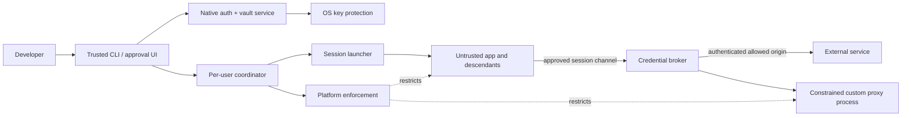

# Threat model

## Assets and attacker

Protect project secrets, other projects, host files outside grants, network destinations outside grants, vault/root keys, authorization decisions, and session isolation. Assume a dependency can execute arbitrary unprivileged native code inside a managed application. It can fork, alter arguments/environment, race filesystem operations, open sockets directly, speak malformed protocols, flood IPC, and deliberately try to kill or evade the runtime.

Trust the OS kernel, verified enforcement mechanisms, signed env-host components, cryptographic libraries, and the human making a correctly presented approval. The attacker may control a project checkout, including proposed configuration and files; project policy is therefore not trusted merely because it lives in the repository.

An already-compromised administrator/kernel, unrelated malware freely executing under the developer's account, physical capture of an unlocked session, or hostile terminal emulator is outside the core guarantee. In particular, env-host cannot promise protection from every same-user process while the developer runs arbitrary other programs outside env-host. Managed descendants themselves must be blocked from attacking trusted services even when they share the user's UID.

## Boundaries

The drawing denotes logical trust boundaries, not proof that a platform implements them. The broker is trusted with selected credentials; arbitrary plugin code is not.

## Required invariants

| ID | Invariant | Principal enforcement |
|---|---|---|
| I01 | Restricted code cannot execute before all boundaries are armed | Two-phase launch, OS containment |
| I02 | Child identity is inherited before any protected operation | Kernel-supported ancestry/lifetime identity |
| I03 | No project or session can use another's secrets or grants | Typed handles, bound grants, peer identity, vault KDF |
| I04 | PID reuse cannot transfer authority | Audit token / process generation / boot identity |
| I05 | ID + fresh authentication are both needed to release project key material | Key derivation + protected root unwrap |
| I06 | Persistent metadata cannot reconstruct the raw project ID | One-way locator, no ID logging/journaling |
| I07 | An approval applies to one live flow or one live session only | Atomic pending-flow consumption, generation fences |
| I08 | Security-component failure cannot expand authority | Persistent OS deny boundary; fail closed |
| I09 | Secure-mode app/custom proxy does not receive raw protected credentials | Trusted injection after validation and transforms |
| I10 | Sensitive logs/config/IPC errors contain no secrets | Data-minimizing structured serialization |
| I11 | Effective policy is authenticated and immutable for a running session | Policy signatures, version/hash pinning |
| I12 | Application terminal streams remain application's streams | Direct FD handoff; separate notifications |

## Threat-to-control map

| Threat | Required controls | Remaining limitation |
|---|---|---|
| Read `~/.ssh`, another project, vault files | OS filesystem deny; minimal grants; deny metadata/vault/control sockets | User-granted directories can contain sensitive copies |
| Symlink/hardlink/rename/FD escape | Native object/path semantics; race tests; no extra inherited descriptors; IPC restrictions | Plain path normalization is not enforcement |
| Shell/child/daemon escape | Pre-exec classification, privilege escalation blocked, descendant containment, host-daemon IPC denied | Unsupported delegated workloads fail |
| Call management IPC from sandboxed CLI | Kernel peer identity + managed-process rejection + auth-bound operations | Same UID or correct binary signature alone is insufficient |
| Fake approval / replay token | Trusted UI, unpredictable IDs, action digest, peer/session/version binding, monotonic expiry | A user can deliberately grant harmful access |
| Exfiltration over allowed destination | Narrow destinations and, in Secure, method/path/body restrictions and credential mediation | Standard cannot stop secrets sent to an already allowed endpoint |
| DNS/CDN/tunnel bypass | Broker-authenticated origin for domain rules; raw address grants explicit; local egress default deny | Any allowed general relay can be an exfiltration channel |
| Proxy compromise | No root, no vault enumeration, bounded session capabilities, denied direct network | Trusted broker/engine remains part of TCB |
| Offline file theft | Auth-protected root + project-dependent encryption | Weak fallback passphrases admit offline guessing; backups persist |
| Kill coordinator/enforcer; event flood | Persistent denial and bounded queues; terminate compromised session | If OS offers no persistent denial, product mode cannot be offered |
| Audit tampering | Separate append writer, permissions, hash chaining, bounded storage | Local hash chain is not tamper proof against root or full rollback |
| Policy edits in project repo | Treat as proposals; authenticated signed effective policy | Already allowed application files can be modified for future runs |

## Honest limitations

- Standard secrets reside in process memory/environment, can be printed by that process, copied by its children, or sent along allowed channels. Revocation cannot erase those copies.
- Secure reduces credential exposure, not all misuse. A hostile application can make permitted billable/destructive requests or place sensitive data in allowed requests. Set operation, size, and rate limits; least-privilege provider keys remain valuable.
- No promise of complete memory erasure in Go, no guarantee against swap/crash dumps outside configured OS protection, no universal side-channel defense, and no cryptographic rollback protection without an external trusted monotonic anchor.
- Default filesystem grants expose the project itself. Package installation/build scripts can damage that project. This is not a version-control backup tool.
- stdin/stdout/stderr are deliberate granted capabilities. Redirecting stdout to a file grants that descriptor even if its path is otherwise denied; reject socket/device descriptors unless explicitly supported. Terminal I/O is not an invisible path to all host files.
- Changing OS security settings or uninstalling the runtime is an authorized administrative action. Clean uninstall must first stop all managed sessions; accidental/crash disappearance still has to fail closed.
- The runtime cannot retract a request that an external service has already executed. Stop prevents new authority and closes channels, not historical side effects.
