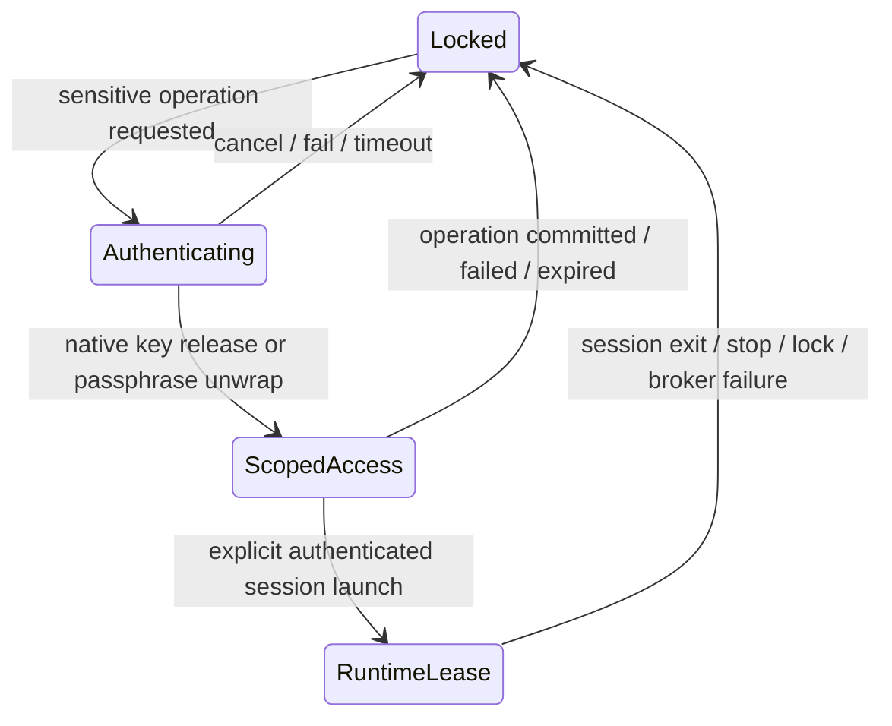

# Vault and authentication design

Status: a precise design for specialist review and implementation; not audited cryptography. No custom cipher, home-grown password KDF, or biometric-derived key is permitted.

## Identity and storage

Generate `P`, 32 bytes from `crypto/rand`. Canonical text is `ehp1_` followed by 52 lowercase, unpadded RFC 4648 base32 characters. Reject wrong length, alphabet, version, or noncanonical trailing bits. Re-encode decoded bytes to check canonical form. The short ID in the requirements is illustrative and is not accepted as a v1 generated ID.

`.h.env` contains exactly `PROJECT_ID=<canonical ID>\n`, mode 0600 where meaningful. The marker is the only long-lived raw-ID copy env-host writes. Read it with no-follow/object validation and a 1 KiB cap. Do not put it in logs, audit records, indexes, keychain labels, telemetry, session journals, errors, or generated examples. Commands may accept explicit IDs but should not echo them; shell history/process inspection can retain user-supplied arguments outside env-host's control.

Derive a public storage locator:

```text
L = SHA-256(UTF8("env-host/project-locator/v1") || 0x00 || P)
```

Index ciphertext by hex `L`. The registration table stores locator, user label, approved root bindings, policy revision, and record version. It never stores `P` or an encrypted recoverable copy of `P`. Names and root paths can reveal project existence; encrypt optional descriptive metadata where useful, but encryption of an ID copy would still violate the loss model.

A common installation root key is internal encryption material, **not a global application-secrets store**. No project inherits secret entries from it or from another project.

## Exact key hierarchy

On first authenticated setup, generate installation root `R` of 32 random bytes and random 16-byte installation ID `I`. Keep `R` only in its selected protected wrapper at rest. For each project write, create fresh 32-byte `S` (key salt), 32-byte metadata key `Km`, and 32-byte value key `Kv`:

```text
KEK = HKDF-SHA256(
    input_key_material = R || P,        # exactly 64 bytes
    salt = S,                          # 32 bytes, stored in envelope
    info = UTF8("env-host/project-wrap/v1") || 0x00 || I || L,
    output_length = 32)

wrapped_keys = AES-256-GCM(KEK, encode(Km, Kv), AAD("keys"))
manifest     = AES-256-GCM(Km, canonical_metadata, AAD("manifest"))
values       = AES-256-GCM(Kv, canonical_values, AAD("values"))
```

Use standard `crypto/hkdf`, `crypto/sha256`, `crypto/aes`, and `crypto/cipher`. All encodings have fixed field order and length prefixes, never ambiguous concatenated strings. Use `cipher.NewGCMWithRandomNonce` with nil/empty caller nonce, whose output includes its nonce. The API requires a per-key message limit; this design generates fresh keys and salt for every committed envelope revision, with no user-controlled nonce. [Go AEAD API](https://pkg.go.dev/crypto/cipher#NewGCMWithRandomNonce).

AAD is a deterministic binary encoding of `format=1, installation_id=I, locator=L, revision=uint64, purpose`, binding all encrypted sections to one project/revision. Do not use a map's arbitrary JSON serialization as AAD. Outer JSON v1 has only `format`, `installation_id`, `locator`, `revision`, `key_salt`, `wrapped_keys`, `manifest`, and `values`; binary fields use canonical base64. Reject unknown/duplicate keys, oversize fields, invalid revisions, and inconsistent lengths before allocation or crypto operations.

Manifest entries contain name, classification (`secret` or `config`), creation/update time, and value revision; no values. Values map valid names to UTF-8 byte values, including empty. Sets must agree exactly. Never interpret values as templates. All imports start classified `secret`; changing classification is authenticated and explicit.

Classifying an entry as `config` also authorizes a deliberately public copy of that value in the signed effective policy's `environment.public_config`. Explain this exposure before committing the change. This permits configuration-only runs without unlocking protected keys. Update vault and public snapshot atomically through the journal; compile rejects a secret-classified name in that snapshot. Reclassifying to secret removes the active public copy but cannot erase historical copies/backups. Ordinary management output still shows names, not values. Never infer public classification from a familiar name such as `DEBUG`.

`snap` opens only the manifest after authentication. It must not decrypt the values blob just to produce names. An explicit reveal can decrypt values inside the vault process and release only the selected entry to the authenticated management action. The CLI never receives `R`, `KEK`, `Km`, or `Kv`.

Per-project bound: 1,024 entries, names at most 128 ASCII characters, 64 KiB per UTF-8 value, 1 MiB total decoded values, 4 MiB envelope. Public configuration is further limited to 256 KiB total decoded values and a serialized policy that fits the control-frame limit. Reject environment-incompatible NUL and invalid names on import/set. Environment launch size is further limited by the platform and must be preflighted without printing values. These conservative v1 limits can later change in a versioned contract.

## Root protection and authentication

Two explicitly selected profiles:

1. **Native protected root (preferred when proven):** a non-synchronizing OS-protected keychain item storing/wrapping `R`, accessible only to the designated trusted vault service and gated by user presence per sensitive operation. Use a fresh authentication context, prohibit silent/reused context approval, and test actual key retrieval after cancellation. Do not infer macOS behavior from an iOS sample. Apple's access-control and biometric documentation establishes key-release gating, not a portable promise about every platform/accessibility flag. [Apple keychain authentication](https://developer.apple.com/documentation/localauthentication/accessing-keychain-items-with-face-id-or-touch-id), [macOS keychain ACLs](https://developer.apple.com/documentation/security/access-control-lists).
2. **Passphrase root wrapper:** derive `Kp` with Argon2id v1.3 using a fresh 16-byte salt, initial parameters 64 MiB / 3 passes / 4 lanes / 32-byte output, then AES-256-GCM-wrap `R`. These are RFC 9106's memory-constrained starting parameters; benchmark and increase cost where practical. Persist bounded parameters and wrapper version. Wrong passphrase and damaged wrapper yield the same user-level unlock failure. [RFC 9106, section 4](https://www.rfc-editor.org/rfc/rfc9106.html#section-4).

Fallback is configured during authenticated enrollment, never created automatically after native authentication fails. A separately configured fallback is another route to the same root and must be visible to the user. If the native profile is unavailable and no fallback exists, return `AUTH_UNAVAILABLE`; do not switch to a plaintext or login-unlocked key file. `golang.org/x/crypto/argon2` is a justified dependency; do not implement Argon2 yourself. Review its maintained version when pinning.

For passphrase mode, offline file possession permits password guessing. Enforced online rate limits cannot prevent that. “Authentication cannot be bypassed with vault files” means there is no plaintext key or UI-only check; it does not mean a weak password becomes unguessable.

Native biometrics authorize protected key material; env-host never sees or stores a fingerprint. Enrollment changes, passcode/password availability, keychain resets, root app identity changes, and headless operation must be separately tested. Do not silently use a keychain item that only checks whether the login keychain is unlocked.

## Operation lifecycle



Auth grant is bound to `(peer process instance, operation, locator, session if any, request digest, expected revision, nonce, monotonic expiry)`. One management grant authorizes one committed action or reveal, expires after 60 seconds, and is consumed atomically. `manage` can stage several edits, preview names/actions, then authenticate one atomic batch; a later batch requires fresh auth. Canceled operations release no secret existence details.

Authentication precedes secret-name lookup and secret-specific errors. After successful auth, `NOT_FOUND` is meaningful. Do not disclose existence through unauthenticated error messages or obviously different code paths; do not claim perfect timing-channel elimination.

`R` and project derivation material are short-lived inside the vault service. Zero mutable buffers on release as best effort, disable sensitive crash diagnostics, and avoid copies/string formatting. Go cannot guarantee all historical copies are erased. A runtime lease contains only the selected project entries or handles necessary for a particular session; the root is never kept unlocked for the session.

Standard receives a copy of selected secret values exactly once at launch. Secure keeps selected credentials in a constrained trusted broker compartment, bound to session/integration/operation. No new prompt per API request. Rotation affects new sessions; terminating/restarting existing leases is required for effective revocation. A provider-side credential rotation may be needed to revoke already exported credentials.

`envh lock` revokes grants and Secure leases and stops restricted sessions that depend on protected credentials, then releases retained material. It cannot erase Standard app memory or external copies. Never claim it can. Authenticated policy mutations do not reuse an existing runtime lease.

## Policy integrity without indefinite vault unlock

Derive an Ed25519 policy-signing seed from `R` using HKDF with a distinct label and installation ID. The vault service signs canonical policy/root-binding documents only after an operation-bound auth check. Persist the public verification key in installation-protected state; managed apps cannot replace it. The coordinator verifies signed effective policy without unlocking the vault. Installation signer compromise is inside the trusted-component threat model; a same-user attacker outside containment is not solved by this signature alone.

Bind signatures to locator, revision, root object bindings, schema version, and complete policy payload. Root path text alone is insufficient. Revision checks detect stale updates in a live installation; signed old backups can still be replayed by an attacker able to roll back all local trusted state. Document that limitation.

## Loss, move, backup, and reinstall

| Event | Required outcome |
|---|---|
| ID known, authentication succeeds, ciphertext/root intact | Project opens |
| ID known, authentication fails | No secret access |
| Root known but every copy of ID lost, no active keys/plaintext survive | Stored ciphertext is computationally unrecoverable under the KDF assumptions |
| `.h.env` deleted but ID exists in backup/history/memory | It is not permanently lost; no claim of cryptographic erasure |
| Marker deleted during active session | Stop on detected identity invalidation; already-exported values and in-flight requests cannot be recalled |
| Marker moves with directory | Authenticated rebind keeps identity; no automatic secret access from a copied marker |
| Native keychain reset / machine reinstalled without root continuity | Existing vault unavailable even if marker and ciphertext survive |
| Passphrase wrapper, ciphertext, ID all copied and passphrase known | Can potentially restore; this does not bypass the ID requirement |
| Passphrase lost and no enrolled alternate auth route | No password-reset recovery of existing ciphertext |
| Project ID lost and owner asks “list my IDs” | List safe labels/locators only; no reconstruction or bypass |
| Old encrypted backups survive deletion/rotation | Old ciphertext/credentials may remain recoverable with old inputs; deletion is not guaranteed physical erasure |

No export/backup command in v0.1. Do not upload or sync root wrappers or markers automatically. Any future backup design must store ID separately from vault export and continue requiring both ID and authentication. The central root alone must never be enough to recover a project's data.

## Persistence and recovery

Single vault writer; per-locator locks; optimistic expected-revision checks. Build the complete new encrypted envelope in memory, write a mode-0600 sibling temporary file in the protected vault directory, fsync it, atomically replace the old envelope, fsync the directory, then publish associated signed metadata via a bounded transaction journal. The journal contains ciphertext and locators only. Authenticate every section before accepting a generation. Inject crashes at each stage and recover to either the old or new valid state, never partially mixed data.

Initialization is a cross-filesystem operation, not a fictional single rename: validate/import in memory, authenticate, establish ignore rule, create the marker exclusively and fsync it, stage encrypted registration/vault, then mark registration complete. Journal only locator/path/status. If interrupted before registration, marker plus authentication can resume; if marker is incomplete, report repair state rather than issue a new ID. Never automatically delete the original import file. A raw ID is not written to a central recovery journal.

Review questions before G0: key separation and AAD, nonce/key lifecycle, wrapper migration, native auth reuse, cross-project ciphertext swaps, active-session loss qualifications, offline guessing, and crash-safe atomic generation changes.
